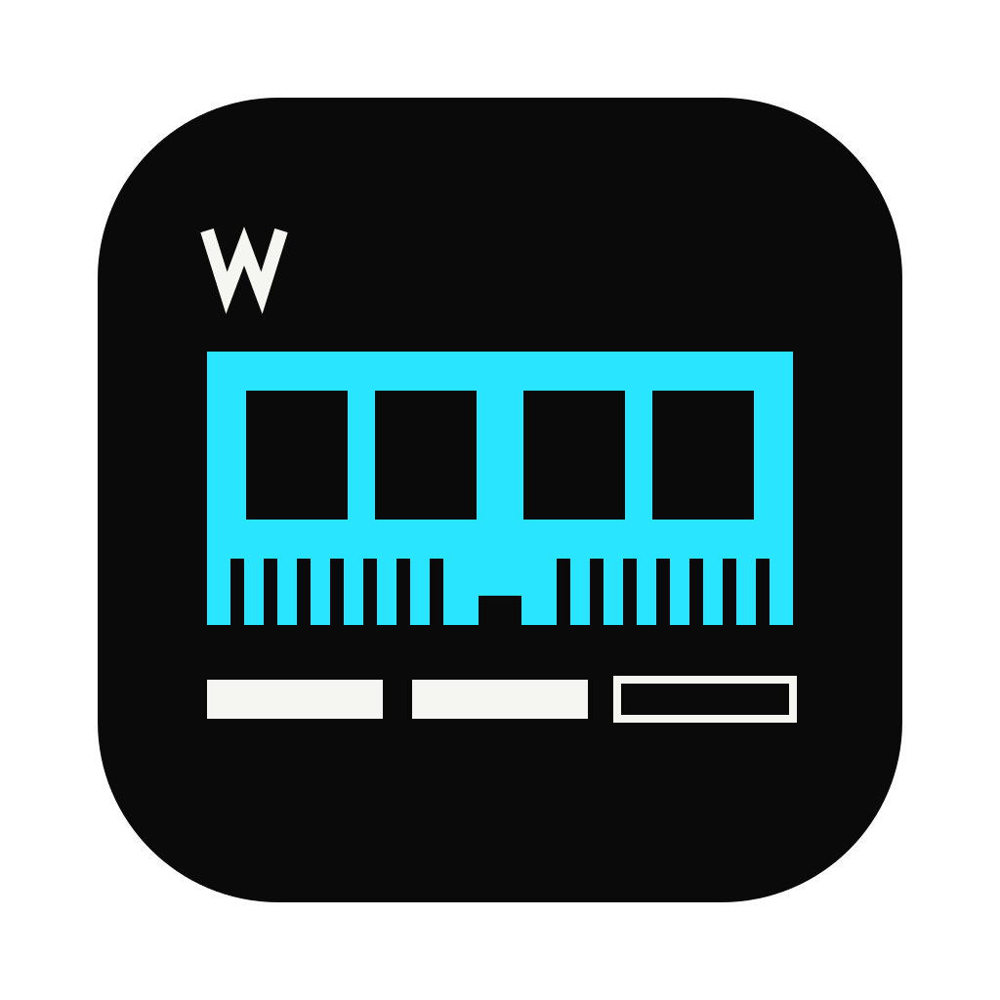
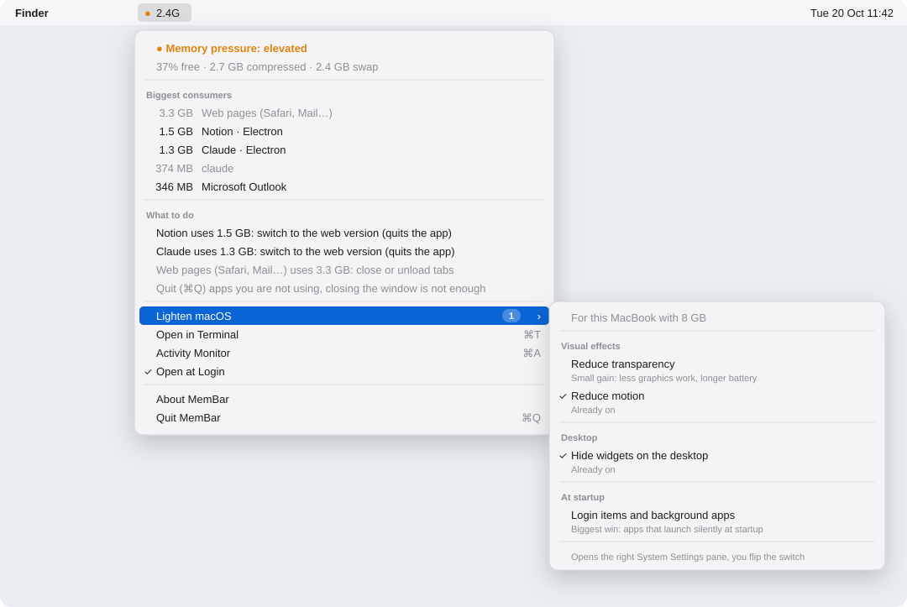

<div align="center">



# MemBar

### Ton Mac 8 Go, expliqué d'un coup d'œil. Et réparé d'un clic.

Une mini-app pour la barre des menus des Mac qui ont peu de mémoire. Elle montre à quel point la mémoire est sous pression,<br>
désigne les apps responsables et te dit quoi fermer.<br>
Pensée sur et pour le **MacBook Neo**. Elle fonctionne sur tout Mac sous macOS 14 ou plus récent.

[](#installation)
[](#léger-comment-)
[](#léger-comment-)
[](LICENSE)

**[Installer](#installation)** · [Comment elle décide](#comment-elle-décide) · [Terminal](#dans-le-terminal--mem) · [English version](README.md)

<picture>
  <source media="(prefers-color-scheme: dark)" srcset="docs/menu-dark.svg">
  
</picture>

<sub>Maquette du vrai menu, faite à partir d'une mesure réelle sur un MacBook Neo (8 Go). L'app s'affiche en français si ton Mac l'est.</sub>

</div>

---

## Pourquoi

Le MacBook Neo a **8 Go de mémoire, soudés et non extensibles**. Pour les mails, un navigateur et quelques apps, ça suffit. Ajoute Notion, Slack et une app d'IA, et ton Mac écrit en silence des gigaoctets de swap sur le SSD.

macOS te prévient rarement quand ça arrive. Le Moniteur d'activité affiche un petit graphique et une avalanche de chiffres, mais ne te dit jamais quoi fermer. Sur GitHub, les « optimiseurs de RAM » se rangent en trois familles :
- des **tableaux de bord**, qui ajoutent encore des chiffres ;
- des **nettoyeurs**, qui lancent `purge` et ne vident qu'un cache pour quelques secondes ;
- des **bidouilles**, qui coupent le swap : sur 8 Go, macOS se met alors à tuer tes apps.

MemBar fait une seule chose : **traduire les chiffres en conseils que tu peux appliquer**.

## Ce qu'elle affiche

| | |
|---|---|
| **● 2,4G** dans la barre des menus | Une pastille selon le niveau de pression mémoire calculé par le noyau lui-même : **● vert, ◐ orange, ▲ rouge**. La forme change aussi, pour se lire sans les couleurs. Suivie du swap utilisé, que tu peux masquer. Rafraîchie toutes les 15 secondes. |
| **Courbe du swap** | Les 30 dernières minutes de swap, une barre par mesure, colorée selon la pression. On voit d'un coup d'œil si ça monte ou si ça tient. |
| **Plus gros consommateurs** | Chaque app est mesurée comme dans la colonne *Mémoire* du Moniteur d'activité, avec ses processus annexes additionnés. Une ligne pour Notion au lieu de quatorze. **Un clic sur une app la quitte.** |
| **Étiquette Electron** | Signale les apps qui embarquent leur propre Chrome. Ce sont souvent les plus lourdes. |
| **Que faire** | De courts conseils calculés d'après ce qui tourne en ce moment. Certains s'appliquent en un clic. |
| **Alléger macOS** | Sur les Mac de 16 Go ou moins : les réglages système qui valent le coup, avec leur état actuel et un badge pour ce qu'il reste à faire. [Détails plus bas](#alléger-macos). |
| **Ouvrir dans le Terminal** | La même mesure en texte, avec la commande `mem`. |

## Comment elle décide

Deux conseils apparaissent quelle que soit la pression, parce qu'il vaut mieux les connaître tôt :

| Tu vois | Parce que | Le clic fait |
|---|---|---|
| *Firefox a pris 700 Mo en 40 min* | Une app a gagné au moins 500 Mo et 50 % par rapport à sa mesure la plus basse de l'heure écoulée, avec au moins 10 minutes de recul. Souvent un onglet qui s'emballe ou une fuite. | Quitte l'app, qui repart à neuf quand tu la rouvres. |
| *3 apps inutilisées depuis plus de 2 h occupent 900 Mo* | Des apps ouvertes qui ne sont pas passées au premier plan depuis 2 h, comptées depuis le lancement de MemBar. Les terminaux, lecteurs de musique et apps d'appel ne sont jamais comptés : les quitter couperait quelque chose. | Les quitte (chacune peut te proposer d'enregistrer). |

Quand la pression est **normale** et le swap faible, le reste se tait : *« Rien à faire, tout va bien 👍 »*. Sinon :

| Tu vois | Parce que | Le clic fait |
|---|---|---|
| *Notion utilise 1,5 Go : passer à la version web* | Une app de plus de 150 Mo existe aussi en version web identique (Notion, Slack, Discord, Teams, Figma, Linear, Spotify, Claude, ChatGPT). | Quitte l'app (qui peut te proposer d'enregistrer) et ouvre la version web dans ton navigateur. |
| *3 apps Electron utilisent 2,1 Go* | Au moins deux apps Electron sont ouvertes, chacune avec son propre moteur Chrome. | — |
| *Le swap a pris 1,2 Go en 25 min* | Un swap qui grossit pendant que tu travailles est le vrai signe d'alerte. Un swap gros mais stable ne l'est pas. | — |
| *Firefox utilise 2,3 Go : fermer ou décharger des onglets* | La pression est tendue et un navigateur dépasse 800 Mo. | — |
| *Le swap atteint 3,4 Go : un redémarrage le videra* | Le swap dépasse 40 % de ta RAM. | — |

Pas de tour de magie : pas de `purge`, pas de `sudo`, aucun réglage du swap ni du noyau. Tu gardes la main.

## Alléger macOS

Ce sous-menu apparaît sur les Mac de **16 Go ou moins**. Sur les Mac de **8 Go**, un badge compte les réglages qu'il reste à activer. MemBar détecte si tu es sur un portable et adapte chaque conseil.

| Réglage | Ce que tu y gagnes vraiment |
|---|---|
| **Réduire la transparence** | Un peu moins de travail pour la puce graphique, et un peu plus d'autonomie sur un portable. |
| **Réduire les animations** | Pareil : moins d'animations à dessiner. |
| **Masquer les widgets du bureau** | Chaque widget tourne dans son propre petit processus. |
| **Ouverture et apps en arrière-plan** | **Le vrai gain.** Des apps qui se lancent en douce à chaque démarrage et restent en mémoire toute la journée. |

**Pourquoi ouvrir les Réglages au lieu de changer le réglage directement ?** macOS interdit aux apps de modifier ces réglages (`defaults write com.apple.universalaccess` échoue avec *« Could not write domain »*). Le seul moyen de contourner ça serait de demander l'accès complet au disque ou le contrôle de l'interface, ce qui est beaucoup trop pour un outil de 400 lignes. MemBar affiche donc **l'état actuel** et ouvre **le bon panneau** en un clic, et c'est toi qui actives.

Pas de promesse exagérée non plus : les effets visuels coûtent quelques dizaines de Mo au maximum. Sur un portable, ils comptent davantage pour la batterie que pour la mémoire.

## Installation

Copie ceci dans le Terminal :

```sh
curl -fsSL https://raw.githubusercontent.com/kxrz/membar/main/install.sh | zsh
```

Environ 5 secondes plus tard, la pastille est dans ta barre des menus et s'ouvrira à chaque connexion.

Le script **compile MemBar sur ton Mac** à partir des ~400 lignes de [`Sources/`](Sources). Il ne télécharge aucun binaire, ne demande aucun droit administrateur et ne déclenche aucune alerte Gatekeeper. Lis-le avant de le lancer : [`install.sh`](install.sh).

Si macOS te propose d'installer les *outils de ligne de commande*, accepte, ou lance d'abord `xcode-select --install`. C'est le compilateur gratuit d'Apple.

**Désinstaller :** `./uninstall.sh`, ou supprime `~/Applications/MemBar.app`, `~/.local/bin/mem` et `~/Library/LaunchAgents/io.github.kxrz.membar.plist`.

**Mises à jour :** une fois par jour, MemBar demande à GitHub le numéro de la dernière version. Rien sur ton Mac n'est envoyé. Quand une nouvelle version sort, une ligne *Mettre à jour* apparaît dans le menu : un clic reconstruit MemBar depuis le code source, comme l'installation, et elle revient en une minute. Pour couper la vérification : `defaults write io.github.kxrz.membar checkUpdates -bool NO`.

## Dans le terminal : `mem`

```
$ mem
● Pression mémoire : tendue  ·  37 % libre · 2,7 Go compressés · 2,4 Go de swap
  3,3 Go   Pages web (Safari, Mail…)
  1,5 Go   Notion  · Electron
  1,3 Go   Claude  · Electron
  374 Mo   claude
  346 Mo   Microsoft Outlook

Que faire
  • Notion utilise 1,5 Go : passer à la version web (quitte l'app)
  • Claude utilise 1,3 Go : passer à la version web (quitte l'app)
  • Pages web (Safari, Mail…) utilise 3,3 Go : fermer ou décharger des onglets
  • Quitter (⌘Q) les apps inutilisées, fermer la fenêtre ne suffit pas
```

## Léger comment ?

- **11 Mo de mémoire** en fonctionnement, mesurés avec `footprint` sur un MacBook Neo. Un outil pour un Mac 8 Go ne doit pas faire partie du problème.
- **0 dépendance.** Du Swift et AppKit, avec des mesures lues directement dans le noyau (`sysctl`, `proc_pid_rusage`).
- **Aucun accès réseau, aucune statistique, aucun compte.** Rien ne s'ouvre en ligne, sauf quand tu cliques sur un conseil « version web ».

## Langues

English, Français, Español, 日本語, 简体中文. MemBar suit l'ordre des langues choisi dans *Réglages Système → Général → Langue et région*, et passe à l'anglais par défaut.

## Licence

[GPL-3.0](LICENSE) © 2026 LesWWW.com (Florent Bertiaux). Toute version redistribuée doit conserver la mention *« Based on MemBar by LesWWW.com »*, comme le précise le fichier [NOTICE](NOTICE).

---

<div align="center"><sub>Une app <b><a href="https://leswww.com">LesWWW.com</a></b>. Why. What. Which way. <i>Pourquoi. Quoi. Par où.</i></sub></div>
